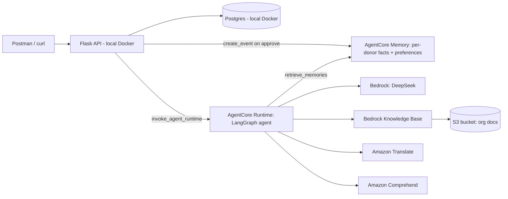

# CLAUDE.md — Donor Outreach v2

Guidance for Claude Code when working in this repo. Read this before making changes.

## What this project is

A Flask + PostgreSQL backend for fundraising campaigns and donor messages (inbound and outbound), with automatic translation via Amazon Translate and language detection via Amazon Comprehend.

**v2 goal (2–3 week scope):** keep the existing Flask/Postgres app as-is and add **one** LangGraph agent, deployed on **AWS Bedrock AgentCore Runtime**. When a donor reply comes in, the agent detects the language, translates it, classifies intent and sentiment, pulls org policy from a Bedrock Knowledge Base, reads what it knows about that donor from AgentCore Memory, and drafts a reply in the donor's language. Staff approve or edit the draft before it's saved as an outbound message.

- v1 (unchanged, do not modify): github.com/jenpandu/Donor_Outreach
- v2 (this repo): github.com/jenpandu/Donor_Outreach_V2
- The full plan is in the claude.ai project doc `claude/plan.md`. If this file and the plan disagree, ask.

Simple beats clever. If a change pulls in something from the "Out" list below, stop and ask first.

## Scope

| In (core) | Out (stretch, only if time remains) |
|---|---|
| Inbound triage agent (LangGraph) | Outbound drafting agent |
| AgentCore Runtime + Memory (long-term, per donor) + built-in Observability | AgentCore Gateway, Identity |
| Bedrock Managed Knowledge Base on S3 (S3 Vectors) | Staff copilot / natural-language queries |
| Approve/edit draft via API endpoint | Bedrock Guardrails |
| Small eval set + unit tests | `donors` table, RDS, ECS, IaC/CDK, CI/CD |
| README + architecture diagram + short demo | Streamlit UI (Postman/curl demo is enough; still an open question) |

## Hard rules

- **LLM: do not use a Claude model.** The agent uses a **DeepSeek model on Amazon Bedrock**, called through `langchain-aws` (`ChatBedrockConverse`). Keep the model ID in config (`BEDROCK_MODEL_ID`), never hard-coded. Check that the chosen DeepSeek model supports tool use / structured output on Bedrock; if it doesn't, have `classify` ask for JSON and validate it with Pydantic.
- **Flask is the source of truth.** Flask owns Postgres and calls the agent. **The agent never touches the database.** Postgres stays in local Docker, so there's no RDS, VPC or Secrets Manager.
- **Approval is a normal API call**, not a LangGraph interrupt. No checkpointer, no paused-graph state.
- **Only the agent deploys to AWS.** One deploy target.
- **AWS failures never block saving a message.** If the agent, Translate, Comprehend, the KB or Memory fails, the message still saves with `original_text` intact, and failed fields stay `null`.
- **No secrets in git.** Never commit `.env`, keys or passwords. Credentials come from a named AWS CLI profile (`AWS_PROFILE`). Keep `.env.example` up to date when adding config.
- Keep the v1 edge-case decisions in `README.md` ("Documented Edge Case Decisions"). Don't change them without asking.

## Architecture



## Repo layout

Existing (v1 code, carried over):

```
src/donor_outreach/
  app.py                 # Flask app factory, blueprints, error handlers
  config.py              # pydantic-settings AppSettings (reads .env)
  extensions.py          # db, migrate, limiter
  errors.py              # DomainError hierarchy -> JSON error envelope
  responses.py           # single_envelope / list_envelope
  logging_config.py      # structlog, one JSON line per request
  api/health.py          # /live, /ready (DB only, not AWS)
  api/messages/          # routes.py (HTTP) + store.py (DB + translation logic)
  schemas/               # Pydantic v2 request/response models
  clients/aws.py         # one shared boto3 Session from AWS_PROFILE; cached clients
  clients/translate/     # Translate wrapper (injectable, stubbable)
  clients/comprehend/    # Comprehend wrapper (injectable, stubbable)
migrations/              # Alembic history; add new revisions, never edit old ones
tests/                   # pytest; conftest builds/drops a fresh test DB per test
docs/erd.md              # ERD; update when the schema changes
postman/                 # Postman collection
```

Planned for v2 (create as you build):

```
agent/
  graph.py               # LangGraph StateGraph + node functions
  state.py               # TypedDict state
  tools.py               # Translate / Comprehend wrapped as LangChain tools
  kb.py                  # Bedrock KB retrieve helper
  memory.py              # AgentCore Memory helpers (retrieve + save_approved_exchange)
  prompts.py             # classify + draft prompts
  entrypoint.py          # BedrockAgentCoreApp @entrypoint wrapping the graph
scripts/
  create_memory.py       # one-time AgentCore Memory resource creation
  run_agent_local.py     # run the graph locally on a sample message
evals/                   # ~20 labeled donor messages + runner
kb_docs/                 # 4–6 short org docs uploaded to S3 (FAQ, gift-receipt policy, tone guide, campaign one-pager)
iam/                     # least-privilege IAM policy JSON(s)
.env.example
```

## The agent graph

State: `donor_id, campaign_def_lang, donor_name, text, detected_lang, confidence, translation, intent, sentiment, kb_context, donor_memory, draft_reply`

```
detect_language ──(confidence < 0.5 or error)──> fall back to campaign_def_lang
       ↓
translate      (skip if detected_lang == def_lang; null on failure)
       ↓
classify       (structured: intent ∈ pledge | question | unsubscribe | complaint | thanks; sentiment)
       ↓
retrieve_kb    (skip for "thanks")
       ↓
load_memory    (AgentCore long-term records for this donor; empty on failure)
       ↓
draft_reply    (in the donor's language; uses kb_context + donor_memory)
```

Node rules:
- Every node catches its own AWS/LLM errors and writes `None`/empty to state instead of raising. The graph must always reach the end.
- Reuse the existing `clients/translate` and `clients/comprehend` wrappers. Don't write new boto3 calls for these.
- Keep nodes as plain functions of state so they can be unit-tested without building the whole graph.

## AgentCore Memory (decided Nov 12)

- **Only long-term memory is read.** Each inbound message is one graph run, so short-term memory adds nothing. Short-term events are written only because AgentCore builds long-term records from them.
- **Strategies:** `semanticMemoryStrategy` (facts like pledges and receipt requests) at `/donors/{actorId}/facts/`, and `userPreferenceMemoryStrategy` (language, tone, contact preferences) at `/donors/{actorId}/preferences/`.
- **IDs:** actor = `donor-<id>`, session = `campaign-<id>`. `messages` has no donor ID yet, so use a normalized `donor_name` (or email) for now.
- **Write on approve, not on draft.** `POST /messages/<id>/approve` calls `save_approved_exchange` (`create_event` with the inbound text and the approved reply). Rejected drafts never reach memory.
- **Fail open.** If `AGENTCORE_MEMORY_ID` is unset or a read/write fails, carry on without memory.
- Long-term extraction is async (about a minute). For demos, wait between approving one message and sending that donor's next one.

## Data model and API changes

One Alembic migration adds these columns to `messages`: `intent`, `sentiment`, `draft_reply`, and `status` (`pending_review` | `approved` | `rejected`). Update `schemas/message.py` (`MessageRead`) and `docs/erd.md` with it.

- `POST /campaigns/<id>/messages/inbound`: calls the agent and saves translation, intent, sentiment and draft with `status=pending_review`. **If the agent call fails, fall back to the v1 translate-only path.**
- **New** `POST /messages/<id>/approve`: optional edited text in the body. Creates the outbound reply message, marks the inbound one `approved`, and writes the exchange to Memory.
- **New** `GET /campaigns/<id>/review-queue`: inbound messages with `status=pending_review`.

Follow the existing patterns: routes stay thin and logic lives in `store.py`, input is validated with Pydantic (422 envelope), not-found raises `DomainError` subclasses, and responses use `single_envelope` / `list_envelope`. Keep the rate limit on the message-logging endpoints.

## Configuration

Existing: `DATABASE_URL`, `TEST_DATABASE_URL`, `AWS_PROFILE`, `AWS_REGION`, `LOG_LEVEL`.

Being added for v2 (add each to `AppSettings` and `.env.example`):
`BEDROCK_MODEL_ID` (DeepSeek), `KNOWLEDGE_BASE_ID`, `AGENTCORE_MEMORY_ID`, `AGENT_RUNTIME_ARN`, `KB_BUCKET`.

## Commands

```bash
pip install -e ".[dev]"                       # install
docker compose up --build                     # Postgres + API on http://127.0.0.1:5000
flask --app donor_outreach.app run            # run locally (needs Postgres + .env)
flask --app donor_outreach.app db migrate -m "msg"   # new migration
flask --app donor_outreach.app db upgrade
pytest                                        # tests (uses TEST_DATABASE_URL)
python scripts/run_agent_local.py             # (planned) run the graph locally
python scripts/create_memory.py               # (planned) create the AgentCore Memory resource
agentcore configure -e agent/entrypoint.py && agentcore launch   # (planned) deploy to Runtime
```

Agent dependencies to add to `pyproject.toml` (put them in an optional `agent` extra if the Flask image shouldn't carry them): `langgraph`, `langchain-aws`, `bedrock-agentcore`, `bedrock-agentcore-starter-toolkit`.

## Testing

- **No live AWS in unit tests.** Stub with `botocore.stub.Stubber` (existing pattern) or inject fakes. Stub the LLM with a fake chat model.
- Each node gets its own unit test, including failure paths: low-confidence fallback, same-language skip, Translate failure → `null`, KB/Memory failure → empty, "thanks" skips KB.
- Flask tests mock the agent invocation and cover the agent-failure fallback, approve (with and without edited text) and review-queue.
- `evals/`: about 20 donor messages across 3–4 languages and every intent, including short tricky ones like "Gracias!". Rerun after prompt changes and report intent accuracy.
- Run `pytest` before saying a change is done.

## Cost and cleanup

Bedrock, Translate and Comprehend are pay-per-call (pennies at this scale). S3 Vectors, AgentCore Runtime and Memory are cheap at demo volume. **Don't use OpenSearch Serverless** for the KB because it has a high idle minimum. After demoing, delete the KB, the Memory resource and the Runtime.

## Known cleanup (Week 1, Day 1)

- Make sure `.env` was never committed (purge it from history if it was) and rotate the DB password. `docker-compose.yml` still hard-codes `POSTGRES_PASSWORD`, so move it to env vars.
- Add the missing `.env.example` and `iam/comprehend-translate-policy.json` (the README links to both).
- Fix the DB vs. Pydantic length mismatches: `def_lang` (5 vs 20) and `donor_name` (20 vs 100).
- Remove the committed `src/donor_outreach.egg-info/` and `.DS_Store`, and add them to `.gitignore`.
- `pyproject.toml` lists `python-dotenv` twice.

## Working conventions

- Python 3.11+, type hints, small functions, structlog for logging (no `print` in app code).
- Commit or push only when asked. Never commit to `main` directly; use a feature branch.
- After adding or changing endpoints, update the README API table and the Postman collection.
- When unsure about scope, pick the simpler option from the plan and say so.
